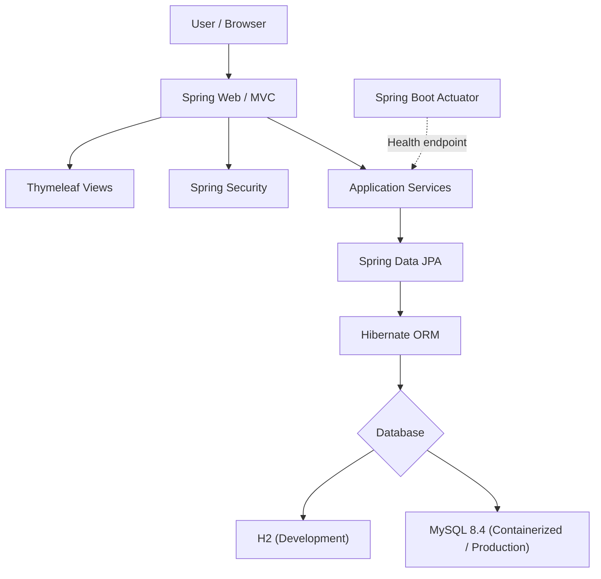
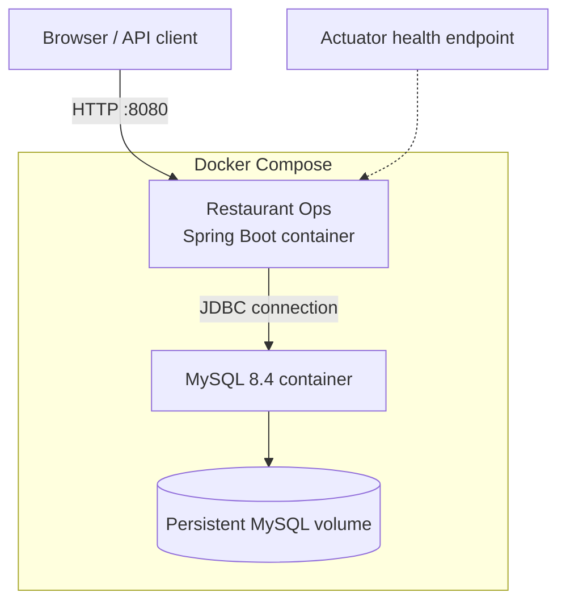
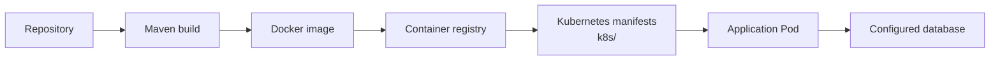

# Restaurant Ops

A Java-based restaurant management web application built with **Spring Boot 3.3.4** and **Java 21**. The project uses Spring MVC and Thymeleaf for web functionality, Spring Security for application security, and Spring Data JPA for persistence.

The repository also includes Docker and Docker Compose configuration, plus Kubernetes deployment resources, to support containerized deployment.

## Tech Stack

| Technology | Purpose |
|---|---|
| Java 21 | Application runtime and development |
| Spring Boot 3.3.4 | Application framework |
| Spring Web | Web and MVC functionality |
| Spring Security | Application security |
| Spring Data JPA / Hibernate | Database access and ORM |
| Thymeleaf | Server-side HTML templates |
| Bean Validation | Input validation |
| H2 | Development database |
| MySQL 8.4 | Containerized / production database |
| Maven | Build and dependency management |
| Docker | Container image |
| Docker Compose | Local multi-container setup |
| Kubernetes | Deployment configuration |
| Spring Boot Actuator | Health and application monitoring |

## Architecture Diagrams

### Interactive architecture generated with GitDiagram

Explore the repository's interactive, AI-generated architecture map on GitDiagram:

**[Open Restaurant Ops in GitDiagram](https://gitdiagram.com/GOMO2005/restaurant-ops)**

GitDiagram lets you explore the main components and follow links from diagram nodes to their source files. You can also export its diagram as a PNG or copy its Mermaid source. See the [GitDiagram project](https://github.com/ahmedkhaleel2004/gitdiagram) for details.

> The interactive diagram is hosted by GitDiagram. The diagrams below are maintained in this README so GitHub can render them directly.

### Application architecture



### Container deployment



### Kubernetes deployment path



The Kubernetes diagram is a deployment overview, not a claim that a database is provisioned by the manifests. Configure database connectivity, image references, secrets, and environment-specific values for your cluster.

### Add the GitDiagram PNG to this repository

To include GitDiagram's exported image directly in the README:

1. Open the [Restaurant Ops GitDiagram](https://gitdiagram.com/GOMO2005/restaurant-ops).
2. Use GitDiagram's **Export PNG** option to download the architecture image.
3. In this repository, create `docs/images/` and add the downloaded file as `gitdiagram-architecture.png`.
4. Add this Markdown where you want the image to appear:

```markdown

```

GitHub renders the Mermaid diagrams above automatically. The exported PNG is an optional static snapshot; the GitDiagram link remains the interactive version.

## Project Structure

```text
restaurant-ops/
├── .mvn/                  # Maven Wrapper configuration
├── k8s/                   # Kubernetes resources
├── src/
│   ├── main/
│   │   ├── java/           # Java application source
│   │   └── resources/      # Configuration and templates
│   └── test/               # Tests
├── .env.example            # Environment variable template
├── Dockerfile              # Multi-stage Docker build
├── docker-compose.yml      # App + MySQL services
├── pom.xml                 # Maven project and dependencies
├── mvnw                    # Maven Wrapper (Unix)
└── mvnw.cmd                # Maven Wrapper (Windows)
```

## Prerequisites

For running locally:

- Java Development Kit (JDK) 21
- Git

For the containerized setup:

- Docker
- Docker Compose

You do not need to install Maven separately; the repository includes the Maven Wrapper.

## Getting Started

### 1. Clone the repository

```bash
git clone https://github.com/GOMO2005/restaurant-ops.git
cd restaurant-ops
```

### 2. Run the application locally

The default development configuration uses an in-memory H2 database.

On Linux or macOS:

```bash
./mvnw spring-boot:run
```

On Windows:

```powershell
.\mvnw.cmd spring-boot:run
```

Open the application at:

```text
http://localhost:8080
```

The development H2 console is configured at:

```text
http://localhost:8080/h2-console
```

The H2 console is enabled in the development configuration and disabled in the production profile.

### 3. Build the application

Linux or macOS:

```bash
./mvnw clean package
```

Windows:

```powershell
.\mvnw.cmd clean package
```

The executable JAR is generated in the `target/` directory.

Run it with:

```bash
java -jar target/restaurant-0.0.1-SNAPSHOT.jar
```

## Run with Docker Compose

The Compose configuration starts the Spring Boot application and a MySQL 8.4 database. MySQL data is stored in a named Docker volume.

### 1. Create your environment file

Copy the example file:

Linux or macOS:

```bash
cp .env.example .env
```

Windows PowerShell:

```powershell
Copy-Item .env.example .env
```

Update `.env` with your own strong local credentials:

```dotenv
MYSQL_ROOT_PASSWORD=replace-with-a-strong-root-password
DB_USER=restaurant
DB_PASSWORD=replace-with-a-strong-database-password
```

Do not commit `.env` or real credentials to version control.

### 2. Build and start the services

```bash
docker compose up --build -d
```

The application is exposed on:

```text
http://localhost:8080
```

### 3. View logs

```bash
docker compose logs -f app
```

For the database:

```bash
docker compose logs -f db
```

### 4. Stop the services

```bash
docker compose down
```

To also remove the database volume and its stored data:

```bash
docker compose down -v
```

**Warning:** `docker compose down -v` permanently removes the Compose database volume.

## Configuration

The application has separate development and production configurations.

### Development

The default configuration uses an in-memory H2 database and runs on port `8080`.

### Production profile

The production profile is activated with:

```text
SPRING_PROFILES_ACTIVE=prod
```

Database connection settings are supplied through environment variables:

| Variable | Description |
|---|---|
| `DB_URL` | JDBC connection URL |
| `DB_USER` | Database username |
| `DB_PASSWORD` | Database password |

Example:

```dotenv
SPRING_PROFILES_ACTIVE=prod
DB_URL=jdbc:mysql://localhost:3306/restaurantdb
DB_USER=restaurant
DB_PASSWORD=your-password
```

Do not place production secrets directly in source files or commit them to Git.

## Health Monitoring

Spring Boot Actuator is included. The application exposes the health endpoint at:

```text
http://localhost:8080/actuator/health
```

The production configuration enables health probes for container orchestration. The Docker image also defines a health check against this endpoint.

## Docker Image

The Dockerfile uses a multi-stage build:

1. Builds the application using Maven and Eclipse Temurin JDK 21.
2. Extracts Spring Boot layers to improve image-layer caching.
3. Runs the application on a lightweight Eclipse Temurin 21 JRE Alpine image.
4. Runs the container as a non-root user.
5. Exposes port `8080` and configures a health check.

Build the image manually:

```bash
docker build -t restaurant-ops:latest .
```

Run the image:

```bash
docker run --rm -p 8080:8080 restaurant-ops:latest
```

For a production run, provide the production profile and database environment variables, and make sure the container can reach the configured database.

## Kubernetes

Kubernetes resource files are maintained in the `k8s/` directory.

Review the manifests and configure the required image, database connectivity, secrets, and environment-specific values before deploying. Apply the resources using:

```bash
kubectl apply -f k8s/
```

Check the deployment status:

```bash
kubectl get pods
kubectl get services
```

The exact resource names and required cluster configuration depend on the manifests and your Kubernetes environment.

## Testing

Run the test suite with:

Linux or macOS:

```bash
./mvnw test
```

Windows:

```powershell
.\mvnw.cmd test
```

## Security Notes

- Keep `.env` files and credentials out of Git.
- Use strong, unique database passwords.
- Use HTTPS when exposing the application outside a trusted local environment.
- Review Spring Security configuration and application authorization rules before production deployment.
- Restrict access to management endpoints and database consoles.
- Review database schema migration and backup practices before production use.

## Contributing

Contributions, suggestions, and bug reports are welcome.

1. Fork the repository.
2. Create a feature branch: `git checkout -b feature/your-feature`.
3. Commit your changes.
4. Push the branch and open a pull request.

## Author

**GOMO2005**

GitHub: [@GOMO2005](https://github.com/GOMO2005)

## License

No license file was visible in the repository when this README was prepared. Unless a license is added, reuse and redistribution are not automatically granted. Add a `LICENSE` file if you intend to publish the project under an open-source license.
